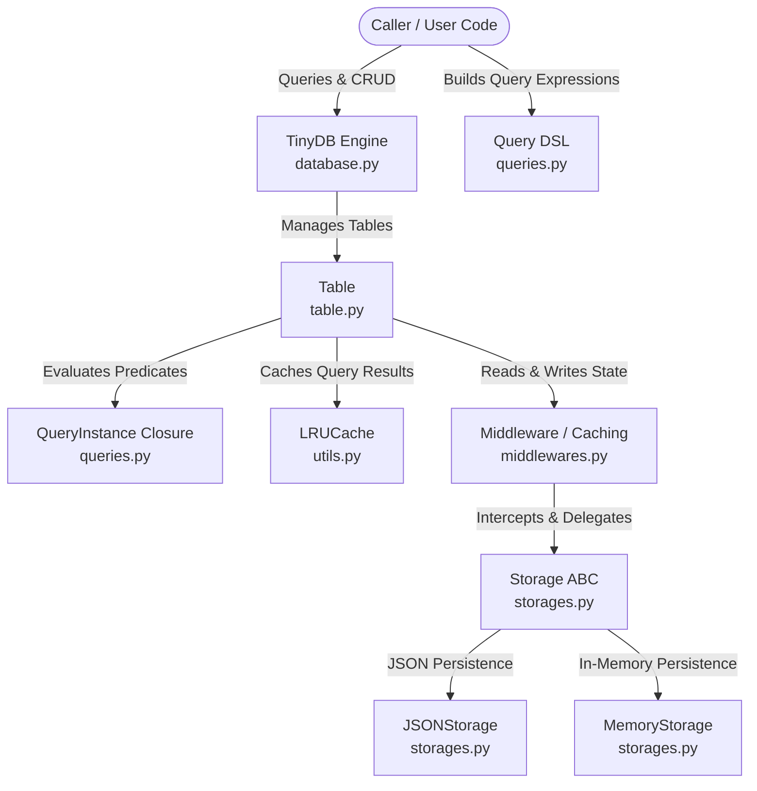

# TinyDB Architecture Documentation

## 1. System Overview

TinyDB is a lightweight, document-oriented database written in pure Python. It has no external dependencies and persists schemaless JSON-like documents. The codebase follows a clean, modular design centered around six primary components:

1. **TinyDB (`tinydb/database.py`)**: The central entry point and database orchestrator. It manages tables, lifecycle operations (close, drop tables), and instantiates the underlying storage medium. By default, it delegates data operations to a default table (`_default`) using `JSONStorage`.
2. **Table (`tinydb/table.py`)**: Responsible for document management, document ID assignment, document mutations (insert, update, upsert, remove), and query caching. The table operates entirely on in-memory dictionary data retrieved from and synchronized back to the storage layer.
3. **Query & QueryInstance (`tinydb/queries.py`)**: Provides an expressive query DSL. A `Query` represents a field path and generates `QueryInstance` predicates. Query instances are callable functional closures returning booleans when evaluated against documents, composable via bitwise operators (`&`, `|`, `~`).
4. **Storage (`tinydb/storages.py`)**: Defines the abstract persistence interface (`Storage`) requiring `read()`, `write(data)`, and `close()`. Concrete implementations include `JSONStorage` (file-based persistence) and `MemoryStorage` (ephemeral testing storage).
5. **Middleware (`tinydb/middlewares.py`)**: An onion-style wrapper around storage classes. It intercepts storage reads and writes to provide cross-cutting capabilities such as write-batching and caching (`CachingMiddleware`).
6. **Utilities & LRUCache (`tinydb/utils.py`)**: Provides supporting data structures, including `LRUCache` for query result caching, `FrozenDict` for hashing nested dictionary structures, and `freeze()` for immutability.

### Component Relationship & Call Graph

---

## 2. Architectural Decision Records (ADRs)

### ADR-1: Layered Decoupling of Table Operations from Storage Serialization
* **Status:** Verified (Documented in commit history and original architecture specifications).
* **Context:** The database must support diverse persistence targets (disk, memory, remote, or compressed formats) without complicating CRUD, indexing, and query evaluation.
* **Decision:** Decouple `Table` and `Storage` into distinct layers. `Table` operates purely on Python dictionaries structured as `{table_name: {doc_id: document}}`. It never handles file I/O or serialization formats directly; all persistence is mediated through the `Storage` abstract base class.
* **Alternatives Considered:**
  1. *Monolithic Table & Storage*: Let each table manage its own independent file and file descriptor. Rejected because multiple tables sharing one database file would require complex multi-file locking and synchronisation.
  2. *Active Record Pattern*: Let individual `Document` instances serialize themselves. Rejected because documents are plain dict subclasses without persistence awareness.
* **Consequences:** Adding new storage formats (e.g., compressed JSON, SQLite, or YAML) requires zero changes to `Table`, `Query`, or caching logic.

### ADR-2: Query Trees as Callable, Composable AST Predicate Closures
* **Status:** Inferred (Derived from class structure in `tinydb/queries.py`).
* **Context:** A query system in a schemaless document store must allow arbitrary comparisons, nested field lookups, regex searches, and custom predicate tests while maintaining fast execution and cacheability.
* **Decision:** Model queries not as SQL-like strings or imperative loops, but as functional callable objects (`QueryInstance`). When invoked with a document (`query(doc)`), the instance traverses the recorded attribute path and applies the predicate function. Boolean operators (`&`, `|`, `~`) construct tree closures that combine the lambdas.
* **Alternatives Considered:**
  1. *String Query Evaluation (eval/exec)*: Parse string expressions. Rejected due to code injection security vulnerabilities and poor performance.
  2. *Imperative Query Builder with Visitor Pattern*: Construct an explicit AST with visitor evaluation. Rejected as overly verbose and heavyweight for a lightweight database.
* **Consequences:** Queries are natural Python expressions (e.g. `User.age >= 18`). Query results can be cleanly cached because each query computes an immutable, deterministic `_hash` tuple via `freeze()`.

### ADR-3: Onion Decorator Pattern for Storage Middlewares
* **Status:** Verified (Explicitly described in `tinydb/middlewares.py:41-65`).
* **Context:** Users require non-intrusive extensions to storage operations, such as in-memory write caching, encryption, or access logging, without subclassing concrete storages.
* **Decision:** Implement a `Middleware` base class that wraps a storage class. The middleware class is instantiated with the target storage class (`Middleware(StorageClass)`), intercepts `read()` and `write()`, and forwards all unknown attribute accesses to the wrapped storage via `__getattr__`.
* **Alternatives Considered:**
  1. *Subclass Hierarchy*: Subclassing `JSONStorage` directly (e.g. `CachingJSONStorage`). Rejected because caching would have to be duplicated for each new storage type (`MemoryStorage`, `YAMLStorage`).
  2. *Event Hooks / Signals*: Publish/subscribe hooks around read and write. Rejected due to performance overhead and complicated error propagation.
* **Consequences:** Middlewares can be nested arbitrarily (e.g. `TinyDB(storage=CachingMiddleware(LoggingMiddleware(JSONStorage)))`). All storages automatically gain caching or middleware capabilities without code changes.

---

## 3. Key Architectural Constraints

When extending or modifying TinyDB, the following five structural rules must not be broken:

1. **No Circular Dependencies in Query DSL:**
   `tinydb/queries.py` must never import `tinydb/table.py` or `tinydb/database.py`. Queries must remain purely functional closures decoupled from storage and table instances.
   *Reference:* `tinydb/queries.py:1-20`.
2. **Storage Subclassing Contract:**
   All persistence storages must subclass `tinydb.storages.Storage` and implement `read() -> Optional[dict[str, dict[str, Any]]]`, `write(data: dict[str, dict[str, Any]]) -> None`, and `close() -> None`.
   *Reference:* `tinydb/storages.py:36-70`.
3. **Empty Storage Returns `None`:**
   A storage's `read()` method must return `None` (not `{}` and not raise `FileNotFoundError` / `EOFError`) when the underlying store is empty or does not exist. `Table._read_table()` relies on `None` to detect a fresh database state.
   *Reference:* `tinydb/storages.py:54-55` and `tinydb/table.py:825-832`.
4. **Deterministic Query Hashability:**
   Every `QueryInstance` must generate an immutable, stable hash tuple (`_hash`) using `tinydb.utils.freeze()` so that `Table._query_cache` can use query objects as dictionary keys. Non-cacheable queries must explicitly set `hashval = None` and degrade safely.
   *Reference:* `tinydb/queries.py:99-103` and `tinydb/utils.py:150-169`.
5. **Middleware Transparency:**
   Middlewares must call `super().__init__(storage_cls)` and delegate unhandled attributes to `self.storage` via `__getattr__`. A middleware must look and behave identical to a raw `Storage` instance from the perspective of `Table` and `TinyDB`.
   *Reference:* `tinydb/middlewares.py:17-23` and `tinydb/middlewares.py:67-74`.

---

## 4. Checked Claims Verification Table

Ten factual claims from this architecture document were verified directly against commit `edff96a` of the codebase:

| # | Claim | Where Checked (file:line) | Correct? | Fix Made |
|---|-------|---------------------------|----------|----------|
| 1 | `Storage` is an abstract base class inheriting from `abc.ABC` | `tinydb/storages.py:36` | Yes | None |
| 2 | `TinyDB` default storage class attribute is named `default_storage_class` | `tinydb/database.py:85` | Yes | Corrected attribute name from `default_storage_cls` to `default_storage_class` |
| 3 | Default table name in TinyDB is `_default` | `tinydb/database.py:80` | Yes | None |
| 4 | `Table` initializes query cache using `LRUCache` with configurable capacity | `tinydb/table.py:107-108` | Yes | None |
| 5 | `QueryInstance` implements callable evaluation (`__call__`) and bitwise operators (`__and__`, `__or__`, `__invert__`) | `tinydb/queries.py:96-139` | Yes | None |
| 6 | `freeze()` recursively transforms `dict` to `FrozenDict`, `list`/`tuple` to tuples, and `set` to `frozenset` | `tinydb/utils.py:150-169` | Yes | None |
| 7 | `CachingMiddleware` default write cache threshold is 1000 operations | `tinydb/middlewares.py:86` | Yes | None |
| 8 | `tinydb/queries.py` does not import `table` or `database` | `tinydb/queries.py:1-20` | Yes | None |
| 9 | `Storage.read()` contract states empty storage returns `None` | `tinydb/storages.py:54-55` | Yes | None |
| 10 | `Middleware.__call__` instantiates the underlying storage class forwarding `*args, **kwargs` | `tinydb/middlewares.py:63` | Yes | None |
